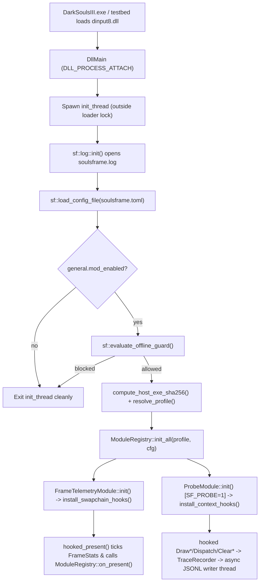

# 09. Codebase reference (M0/M1 foundation + M2 probe v1 + M3 GPU timing)

This reference explains every directory, source file, and symbol currently implemented in the repository.

## 1. Execution flow at startup

## 2. Build & tooling files

| File | Purpose |
|---|---|
| [CMakeLists.txt](../CMakeLists.txt) | Root build graph: builds pure static libraries `soulsframe_core` and `soulsframe_probe_core`, plus either Windows `dinput8.dll` + `d3d11_testbed.exe` or native Linux `soulsframe_unit_tests` and `soulsframe_benchmarks`. |
| [CMakePresets.json](../CMakePresets.json) | Named configurations: `win64-release`, `win64-probe`, `host-tests`, `host-asan`, `host-cov`, `host-bench`. |
| [cmake/deps.cmake](../cmake/deps.cmake) | Pinned `FetchContent` dependencies (`tomlplusplus` v3.4.0, `xxHash` v0.8.4, `MinHook` v1.3.4, `doctest` v2.5.3) with `BUILD_SHARED_LIBS=OFF`. |
| [cmake/toolchains/mingw-w64-x86_64.cmake](../cmake/toolchains/mingw-w64-x86_64.cmake) | Cross-compile toolchain supporting both Fedora and Debian/Ubuntu MinGW sysroot layouts. |
| [docker/build.Dockerfile](../docker/build.Dockerfile) | Reproducible Fedora 43 MinGW-w64 + CMake + Ninja + ccache + clang-tools container (`sf-build`). |
| [docker/wine-test.Dockerfile](../docker/wine-test.Dockerfile) | Headless Fedora 43 + Wine + Xvfb + Mesa container (`sf-wine-test`). |
| [justfile](../justfile) | Task runner shortcuts (`img-build`, `build`, `probe`, `test-host`, `test-cov`, `bench`, `smoke`, `deploy`). |
| [config/soulsframe.toml.example](../config/soulsframe.toml.example) | Default documented configuration template shipped to users (including `[probe]` settings). |

## 3. Pure C++ modules (Linux-testable, no Win32/D3D11)

| Module | Key symbols | Responsibility |
|---|---|---|
| [src/core/config.h](../src/core/config.h) / [.cpp](../src/core/config.cpp) | `sf::Config`, `sf::parse_config_toml()`, `sf::load_config_file()` | TOML parsing with bounds clamping, warning collection, and safe fallback on syntax errors. |
| [src/core/offline_guard.h](../src/core/offline_guard.h) / [.cpp](../src/core/offline_guard.cpp) | `sf::OfflineCheckInput`, `sf::evaluate_offline_guard()` | Enforces explicit `offline_acknowledged = true` opt-in and rejects online flags/session state. |
| [src/core/module.h](../src/core/module.h) | `sf::Module`, `sf::PresentCtx` | Plugin interface for features; uses opaque `void* swap_chain` to keep core decoupled from D3D11. |
| [src/core/module_registry.h](../src/core/module_registry.h) / [.cpp](../src/core/module_registry.cpp) | `sf::ModuleRegistry`, `sf::ModuleStatus` | Initializes, updates (`on_present`), and shuts down modules independently with exception isolation, config kill switches, and `requires_engine_hooks()` checks. |
| [src/core/sha256.h](../src/core/sha256.h) / [.cpp](../src/core/sha256.cpp) | `sf::sha256_bytes()`, `sf::sha256_hex()` | Zero-dependency SHA-256 implementation for executable version pinning. |
| [src/timing/frame_stats.h](../src/timing/frame_stats.h) / [.cpp](../src/timing/frame_stats.cpp) | `sf::timing::IClock`, `sf::timing::FrameStats`, `sf::timing::FrameMetrics` | Rolling ring-buffer frame-time stats (avg, FPS, 1%/0.1% lows, >2x median spikes). |
| [src/timing/gpu_timing.h](../src/timing/gpu_timing.h) / [.cpp](../src/timing/gpu_timing.cpp) | `sf::timing::gpu_ticks_to_ms()`, `resolve_gpu_frame()`, `GpuSlotRing` | Pure GPU-timestamp math (ticks to ms, N+1 stamps to N pass segments, rejects disjoint/zero-frequency/non-monotonic data) and the in-flight query slot ring. |
| [src/probe/gpu_join.h](../src/probe/gpu_join.h) / [.cpp](../src/probe/gpu_join.cpp) | `sf::probe::GpuFrameJoiner`, `ReadyFrame` | Holds per-frame snapshots up to 8 frames until the late GPU result arrives, attaches `gpu_ms`, preserves frame order, times out lost queries. |
| [src/tex/content_hash.h](../src/tex/content_hash.h) / [.cpp](../src/tex/content_hash.cpp) | `sf::tex::hash_bytes()`, `sf::tex::hash_hex()` | Fast 64-bit `XXH64` content hashing for future texture and shader registries. |
| [src/hooks/sigscan.h](../src/hooks/sigscan.h) / [.cpp](../src/hooks/sigscan.cpp) | `sf::hooks::parse_pattern()`, `sf::hooks::sigscan()` | IDA-style byte-signature parser/scanner that refuses ambiguous multiple matches. |
| [src/games/ds3/profile.h](../src/games/ds3/profile.h) / [.cpp](../src/games/ds3/profile.cpp) | `sf::GameProfile`, `sf::games::ds3::resolve_profile()` | Build-hash lookup; unknown hashes disable engine hooks while keeping telemetry active. |
| [src/probe/trace_types.h](../src/probe/trace_types.h) / [.cpp](../src/probe/trace_types.cpp) | `sf::probe::TraceRecorder`, `DrawCallState`, `classify_pass()`, `PassSummary`, `CallSiteStats` | Pure-C++ M2 draw-call aggregator, pass-boundary detector, resource deduplicator, and heuristic pass classifier (`particles_alpha`, `gbuffer`, `shadow`, etc.). |
| [src/probe/jsonl_writer.h](../src/probe/jsonl_writer.h) / [.cpp](../src/probe/jsonl_writer.cpp) | `sf::probe::format_session_header()`, `serialize_frame_snapshot()`, `json_escape()` | Pure-C++ JSONL event serializer emitting `session_header`, `resource`, `frame`, `gpu_pass`, and `draw_site` records. |

## 4. Windows DLL & D3D11 hook layer

| File | Key symbols | Responsibility |
|---|---|---|
| [src/core/proxy_dinput8.cpp](../src/core/proxy_dinput8.cpp) | `DirectInput8Create` | Exports `DirectInput8Create` and forwards calls to `%SystemRoot%\System32\dinput8.dll`. |
| [src/core/log.h](../src/core/log.h) / [.cpp](../src/core/log.cpp) | `sf::log::init()`, `SF_LOG()`, `sf::log::module_dir()` | Thread-safe logger creating `soulsframe.log` alongside `dinput8.dll`. |
| [src/core/win_helpers.h](../src/core/win_helpers.h) / [.cpp](../src/core/win_helpers.cpp) | `sf::WinClock`, `compute_host_exe_sha256()`, `detect_known_overlays()` | QPC monotonic clock, executable hashing, CLI tokenization, conflicting overlay detection. |
| [src/gfx/d3d11/swapchain_hook.h](../src/gfx/d3d11/swapchain_hook.h) / [.cpp](../src/gfx/d3d11/swapchain_hook.cpp) | `install_swapchain_hooks()`, `hooked_present()`, `hooked_resize_buffers()` | Creates a dummy D3D11 device to resolve `IDXGISwapChain` vtable slots 8 & 13 and hooks them with MinHook. |
| [src/gfx/d3d11/context_hook.h](../src/gfx/d3d11/context_hook.h) / [.cpp](../src/gfx/d3d11/context_hook.cpp) | `install_context_hooks()`, `remove_context_hooks()` | (`SF_PROBE=1` only) Hooks 7 `ID3D11DeviceContext` vtable slots (`DrawIndexed`, `Draw`, `DrawIndexedInstanced`, `DrawInstanced`, `Dispatch`, `ClearRenderTargetView`, `ClearDepthStencilView`), capturing RTV/blend/depth/shader/RVA state cleanly with COM reference counting and re-entrancy guards. |
| [src/gfx/d3d11/gpu_timer.h](../src/gfx/d3d11/gpu_timer.h) / [.cpp](../src/gfx/d3d11/gpu_timer.cpp) | `sf::gfx::GpuTimer`, `GpuFrameResult` | (`SF_PROBE=1` only) D3D11 `TIMESTAMP`/`TIMESTAMP_DISJOINT` queries in an 8-slot ring: one stamp per pass start plus end of frame, polled with `DONOTFLUSH` so the GPU is never stalled; degrades to no `gpu_ms` if queries are unsupported. |
| [src/probe/probe_module.h](../src/probe/probe_module.h) / [.cpp](../src/probe/probe_module.cpp) | `sf::probe::ProbeModule` | (`SF_PROBE=1` only) `sf::Module` implementation bridging `context_hook` -> `TraceRecorder` -> background JSONL writer thread with loader-lock-safe shutdown. |
| [src/core/dllmain.cpp](../src/core/dllmain.cpp) | `DllMain`, `init_thread`, `FrameTelemetryModule` | Spawns background initialization outside loader lock, registers active modules (`FrameTelemetryModule`, plus `ProbeModule` in `SF_PROBE`), and orchestrates clean shutdown. |

## 5. Tests and verification scripts

| File | Layer | Purpose |
|---|---|---|
| [tests/unit/](../tests/unit/) | L1 (Linux native) | 13 `doctest` suites (51 test cases, 870 assertions) stress-testing all pure C++ modules (`soulsframe_core` + `soulsframe_probe_core`) and adversarial inputs with `SF_WERROR=ON`. |
| [tests/bench/](../tests/bench/) | L1 (Linux Release) | Micro-benchmark harness and 12 Release `-O3` benchmarks (`soulsframe_benchmarks`) measuring `FrameStats`, `TraceRecorder`, `jsonl_writer`, `XXH64`, `SHA-256`, `sigscan`, and `parse_config_toml` with `--json` artifact export. |
| [tests/fuzz/](../tests/fuzz/) | L2 (Linux libFuzzer + ASan/UBSan) | 3 libFuzzer targets (`fuzz_config`, `fuzz_sigscan`, `fuzz_probe_jsonl`) and seed corpora exercised on every CI run. |
| [scripts/ci/run-coverage.sh](../scripts/ci/run-coverage.sh) | L1 (Linux `gcovr`) | Configures `host-cov`, runs `ctest`, generates HTML/XML/JSON reports, and enforces `SF_MIN_LINE_COVERAGE=90`. |
| [tests/testbed/d3d11_testbed.cpp](../tests/testbed/d3d11_testbed.cpp) | L4/L5 (Wine/Windows) | Minimal D3D11 window that loads `dinput8.dll`, renders frames, and supports `--resize`, `--msaa 4`, and `--particles` (HLSL VS+PS + instanced alpha-blended draws). |
| [scripts/smoke-test.sh](../scripts/smoke-test.sh) | L4 | 4-scenario Wine smoke suite testing blocked offline-guard behavior, 300-frame `ResizeBuffers`, 150-frame MSAA 4x swapchains, and `SF_PROBE` 20-frame JSONL capture with `--particles`. |
| [scripts/ci/check-guards.sh](../scripts/ci/check-guards.sh) | L0 | Rejects tracked game binaries/zips, `<windows.h>`/`<d3d11.h>` leaks in pure modules, RVA leaks outside `ds3/`, unpinned or non-HTTPS dependencies, missing licenses, weak offline defaults, missing PE mitigations, and missing `///` header docstrings. |
| [tools/py/analyze_capture.py](../tools/py/analyze_capture.py) | Host | Stdlib-capable telemetry, pass-breakdown, draw-site hotspot, and `smoke-result.json` analyzer (`--self-test` verified in CI) paired with exact-pinned [tools/py/requirements.txt](../tools/py/requirements.txt). |
| [SECURITY.md](../SECURITY.md) | Policy | Repository security policy, offline-only threat model, PE exploit mitigations (`HIGH_ENTROPY_VA`, `DYNAMIC_BASE`, `NX_COMPAT`), and Security Advisories reporting. |
| [.github/dependabot.yml](../.github/dependabot.yml) | Deps | Multi-ecosystem weekly Dependabot scanning across `github-actions`, `docker` (`/docker`), and `pip` (`/tools/py`). |
| [.github/workflows/](../.github/workflows/) | CI/CD | Automated `ci.yml` (`guards`, `gitleaks`, strict `docs`, `static-analysis`, `host-tests`, `coverage`, `fuzz-smoke`, `win64` + PE mitigation check, `wine-smoke`, `docker-verify`), `security.yml`, `codeql.yml`, `auto-merge.yml`, and `release.yml`. |
