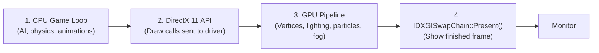
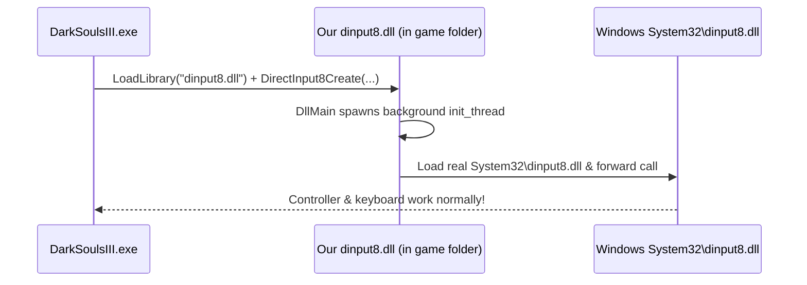

# 10. Deep Dive for Learners and Vibe Coders (Zero to Systems Engineer)

Welcome! If you opened this repository thinking *"I am not a C++ programmer, I just want to understand what is going on, learn deeply, contribute safely, and build real high-value skills"* — this guide was written specifically for you.

Everything here connects directly to the real files in SoulsFrame so you can read an explanation, click the source file, and see the exact lines that make it real.

---

## Part 1: What Happens in One 16.6-Millisecond Game Frame

When Dark Souls III runs at 60 FPS, your computer creates and displays a fresh picture **60 times every second** (`1000 ms / 60 = 16.67 ms` per frame). Inside each tiny 16.6-millisecond budget, two completely different machines cooperate:



Wait — why does a modern PC sometimes stutter in Dark Souls III even at "60 FPS average"?

Because **average FPS hides micro-stutters**. Imagine 59 frames take `14 ms`, and 1 single frame takes `50 ms` while compiling a shader or drawing huge overlapping transparent fog clouds. Your FPS counter still reads ~58 FPS, yet your eyes see a jarring freeze!

**SoulsFrame sits right at step 2 and step 4** (`IDXGISwapChain::Present`) so it can:

1. Measure the exact time of *every single frame* (not just averages).
2. Catch sudden spikes (`> 2x median frame time`) and tail latency (`1% low` / `0.1% low`).
3. Measure GPU passes safely in future milestones (`M2`–`M7`) before touching any rendering optimization.

---

## Part 2: Six Core Systems Concepts Explained Simply

### 1. DLL Proxying (`dinput8.dll`) — The Polite Receptionist Trick

**What is a DLL?**
On Windows, programs don't pack every feature into one giant `.exe`. Instead, they ask Windows to load helper libraries called **Dynamic Link Libraries** (`.dll`), such as controller input (`dinput8.dll`) or DirectX 11 (`d3d11.dll`).

**How Windows searches for a DLL:**
When `DarkSoulsIII.exe` starts, Windows checks **the game's own folder first** before checking `C:\Windows\System32\`.

That single rule makes non-invasive modding possible:



See the actual implementation in [src/core/proxy_dinput8.cpp](../src/core/proxy_dinput8.cpp) and [src/core/dllmain.cpp](../src/core/dllmain.cpp).

**Why `DllMain` spawns `init_thread` instead of doing work directly:**
While Windows is loading a DLL inside `DllMain`, it holds a global lock called the **OS Loader Lock**. Calling `LoadLibrary`, creating D3D11 devices, or touching heavy APIs directly inside `DllMain` can deadlock the entire process. Spawning `CreateThread(..., init_thread, ...)` exits `DllMain` immediately and runs setup safely outside the lock.

---

### 2. COM Vtables & MinHook Trampolines — Intercepting Functions Without Source Code

We do not have the source code to Dark Souls III or Microsoft's `dxgi.dll`. So how does SoulsFrame run its own timer code inside `IDXGISwapChain::Present()`?

#### Step A: Finding the secret phonebook (the Vtable)

DirectX 11 objects are **COM objects**. Under the hood, the first 8 bytes of any `IDXGISwapChain*` pointer in 64-bit memory hold the address of a lookup table called a **vtable** (Virtual Method Table) — essentially a numbered array of function pointers:

| Slot index | Method name | Role |
|---|---|---|
| `0..2` | `QueryInterface`, `AddRef`, `Release` | Lifetime & reference counting (`IUnknown`) |
| `3..6` | `SetPrivateData`, ... | Object metadata (`IDXGIObject`) |
| `7` | `GetDevice` | Owning D3D11 device (`IDXGIDeviceSubObject`) |
| **`8`** | **`Present`** | **Called once per frame to flip image to screen** |
| **`13`** | **`ResizeBuffers`** | **Called whenever resolution/window size changes** |

Look at [src/gfx/d3d11/swapchain_hook.cpp](../src/gfx/d3d11/swapchain_hook.cpp): SoulsFrame creates a tiny hidden 64x64 throwaway D3D11 window, reads `vtable[8]` and `vtable[13]` (which point into the shared `dxgi.dll` code already loaded in memory), and destroys the dummy window!

#### Step B: Bending the road with MinHook

Once we have the real address of `IDXGISwapChain::Present`, **MinHook** performs a **detour hook**:

1. Copies the first few CPU instructions of real `Present` into a small executable buffer called a **trampoline** (`g_orig_present`).
2. Overwrites those first bytes in `Present` with a 64-bit `JMP` instruction pointing to our `hooked_present()`.
3. Every frame, DS3 calls `Present` -> CPU jumps to our `hooked_present()` -> we record frame timing -> we call `g_orig_present(...)` (the trampoline), which executes the original prologue instructions and returns smoothly into Microsoft's `Present`!

---

### 3. Signature Scanning (`AOB`) — Surviving Game Patches

Hardcoding a raw memory address like `0x140ABCDEF` breaks the moment FromSoftware releases a tiny 1 MB patch, because every function shifts to new addresses.

Instead, tools inspect compiled machine code patterns (Array of Bytes / IDA-style signatures):

```text
48 8B 05 ? ? ? ? 48 85 C0
```

- Hex pairs (`48`, `8B`, `05`) match **exact machine opcodes** (instructions that rarely change across small patches).
- Wildcards (`?` or `??`) ignore **changing 32-bit offsets** embedded inside the instruction.

Look at [src/hooks/sigscan.cpp](../src/hooks/sigscan.cpp): notice one crucial engineering choice — if a pattern matches **twice or more** (`matches > 1`), `sigscan()` returns `ScanStatus::Ambiguous` and refuses to hook! Better to disable a feature safely than patch the wrong function in memory.

---

### 4. Ring Buffers & Frame Pacing (`p99` and `p99.9` Lows)

Why does [src/timing/frame_stats.cpp](../src/timing/frame_stats.cpp) store frame deltas inside a **fixed-capacity circular ring buffer** (`FrameStats`) instead of growing a `std::vector` forever?

1. **Predictable zero-allocation hot path:** Once warmed up (`120` or `1000` frames), `record_frame_ms()` overwrites `samples_[write_idx_]` in `O(1)` time without ever asking the OS for new heap memory (`malloc`/`new`) inside the render loop!
2. **Focus on worst frames, not averages:** `compute_metrics()` sorts a snapshot copy to find:
   - **`p1_low_ms` (99th percentile):** 99% of frames finished faster than this; the worst 1% took at least this long.
   - **`p0_1_low_ms` (99.9th percentile):** catches rare severe stalls.
   - **`spike_count`:** frames taking more than **2.0x the median** frame time.

---

### 5. Offline-Only Safety & Unknown-Build Isolation

Modding an online-enabled FromSoftware game carries permanent anti-cheat/ban risk if hooks inject online. SoulsFrame protects users with **defense in depth**:

1. **Config template default ([config/soulsframe.toml.example](../config/soulsframe.toml.example)):** Ships with `offline_acknowledged = false`.
2. **Offline guard ([src/core/offline_guard.cpp](../src/core/offline_guard.cpp)):** Checks `offline_acknowledged`, command-line flags (`--online`, `-online`, `--force-online` case-insensitively), and online session flags before installing any hook.
3. **Executable SHA-256 pinning ([src/core/sha256.cpp](../src/core/sha256.cpp) & [src/games/ds3/profile.cpp](../src/games/ds3/profile.cpp)):** Hashes the host `.exe` cleanly without Win32 crypto dependencies; unverified builds disable memory hooks automatically while keeping safe telemetry working.
4. **Module fault isolation ([src/core/module_registry.cpp](../src/core/module_registry.cpp)):** Wraps `init()`, `on_present()`, and `shutdown()` inside `try / catch (...)` per module. If any experimental module throws an exception, only that module turns off and the game never crashes.

---

### 6. The "Pure Brain" vs "Windows Hands" Split

Look at [CMakeLists.txt](../CMakeLists.txt) and [scripts/ci/check-guards.sh](../scripts/ci/check-guards.sh). All business logic (`config`, `offline_guard`, `module_registry`, `sha256`, `sigscan`, `content_hash`, `frame_stats`, `ds3/profile`) lives in **pure C++20** with **zero** `<windows.h>`, `<d3d11.h>`, or `<dxgi.h>` includes.

Result: you can compile and run **23 test cases / 605 assertions** natively on Linux in **0.06 seconds** without booting Windows or Dark Souls III!

---

## Part 3: How Our Cross-Platform Containers and Harsh CI Protect You

As a learner or vibe coder, the biggest fear when editing C++ is *"What if I silently introduce memory corruption, a security leak, or break Windows compilation?"*

SoulsFrame builds an **automated multi-gate safety net** in [.github/workflows/ci.yml](../.github/workflows/ci.yml) and [.github/workflows/codeql.yml](../.github/workflows/codeql.yml):

| Gate | What it catches | Where configured |
|---|---|---|
| Repository & Layering Guards | Forbidden `.exe`/`.dll`/game files, pure modules importing `<windows.h>`, missing `///` docstrings, unpinned dependencies, missing licenses, weak offline defaults | [scripts/ci/check-guards.sh](../scripts/ci/check-guards.sh) |
| Secret Scanning (`gitleaks`) | Accidental API keys, tokens, or credentials anywhere in Git history | [.github/workflows/ci.yml](../.github/workflows/ci.yml) |
| Format & Markdown Linting | Inconsistent formatting (`clang-format --Werror`) and broken Markdown (`markdownlint-cli2`) | [.clang-format](../.clang-format), [.markdownlint-cli2.jsonc](../.markdownlint-cli2.jsonc) |
| Harsh Static Analysis | Bug-prone patterns, C++20 safety, dead code (`clang-tidy --warnings-as-errors='*'` + `cppcheck --error-exitcode=1`) | [.clang-tidy](../.clang-tidy) |
| Security SAST (`CodeQL`) | Buffer overflows, taint bugs, C/C++ security vulnerabilities (`security-extended`) | [.github/workflows/codeql.yml](../.github/workflows/codeql.yml) |
| Compiler `-Werror` + ASan/UBSan | Memory out-of-bounds, use-after-free, undefined behavior across both `g++` and `clang++` | [CMakeLists.txt](../CMakeLists.txt), [CMakePresets.json](../CMakePresets.json) |
| MinGW Cross-Compile + Import Audit | Ensures static binary (`DirectInput8Create` exported, zero dynamic `libstdc++`/`libgcc_s`/`libwinpthread` DLL leaks) | [docker/build.Dockerfile](../docker/build.Dockerfile) |
| 3-Scenario Wine + Xvfb D3D11 Smoke | Boots a real D3D11 window loading our `dinput8.dll`: verifies offline block, 300-frame resize hooking, and 150-frame MSAA 4x stability | [scripts/smoke-test.sh](../scripts/smoke-test.sh), [tests/testbed/d3d11_testbed.cpp](../tests/testbed/d3d11_testbed.cpp) |
| Container Reproducibility | Rebuilds `docker/build.Dockerfile` from scratch in CI | [docker/build.Dockerfile](../docker/build.Dockerfile) |
| Automated PR Approval & Merge | Once ALL gates pass, approves and auto-merges verified feature & Dependabot PRs into `main` | [.github/workflows/auto-merge.yml](../.github/workflows/auto-merge.yml) |

---

## Part 4: Vibe-Coder Contribution Recipes

Want to contribute your first real improvement today? Pick one of these safe paths!

### Recipe A: Add a New Stress or Edge-Case Unit Test

1. Open any file in `tests/unit/` (for example [tests/unit/test_sigscan.cpp](../tests/unit/test_sigscan.cpp)).
2. Ask your AI assistant (or write yourself):
   *"Add a new `TEST_CASE` in `tests/unit/test_sigscan.cpp` testing pattern matching at unaligned offsets with lowercase hex, then build with `cmake --preset host-tests -DSF_WERROR=ON && cmake --build --preset host-tests && ctest --preset host-tests --output-on-failure`."*
3. Run `bash scripts/ci/check-guards.sh`.

### Recipe B: Add a New Configuration Toggle

1. Add the field (with a safe default and `///` docstring) to `Config` in [src/core/config.h](../src/core/config.h).
2. Parse and validate its range in [src/core/config.cpp](../src/core/config.cpp).
3. Document the key in [config/soulsframe.toml.example](../config/soulsframe.toml.example).
4. Add unit tests for valid, invalid-type, and out-of-range values in [tests/unit/test_config.cpp](../tests/unit/test_config.cpp).

### Recipe C: Add a Pure-C++ Performance / Telemetry Helper

1. Create a pure header/source pair (no `<windows.h>`!) and register it in `soulsframe_core` inside [CMakeLists.txt](../CMakeLists.txt).
2. Expose it behind a `sf::Module` implementation so `ModuleRegistry` gives you kill-switch support and crash isolation for free.

---

## Part 5: How to Profit and Build High-Value Engineering Leverage

Learning by building and maintaining a project like SoulsFrame gives you skills that stand out dramatically in technical interviews, freelance contracts, and product engineering because **very few developers understand how high-level software touches OS APIs, GPUs, and automated quality gates**:

1. **Systems & Low-Latency C++20 Engineering:**
   - Understanding ABI boundaries, static linking (`-static-libstdc++`), lock-free/zero-allocation ring buffers, and memory/UB sanitizers directly transfers to **game engines, trading systems, audio/video processing, browsers, and embedded systems**.
2. **Graphics Pipeline & Performance Profiling Literacy:**
   - Reading D3D11 frame timing, swapchain flip models, tail latency (`p99` / `p99.9` lows), and draw-call pass costs equips you to **profile and optimize Unity/Unreal/custom engines**, GPU compute workloads, and indie/AA studio releases.
3. **Reverse Engineering & Binary Security Awareness:**
   - Knowing how PE executables work, how virtual method tables dispatch calls in memory, and how byte signatures + SHA-256 build pinning prevent brittle patches is core knowledge for **security research, anti-tamper/compatibility engineering, and legacy binary maintenance**.
4. **Production DevSecOps & Reproducible Cross-Platform CI:**
   - Designing multi-compiler matrices (`g++`, `clang++`, `mingw-w64`), containerized builds (`Podman`/`Docker`), `CodeQL`, `gitleaks`, `clang-tidy`, `cppcheck`, headless GUI testing under `Xvfb + Wine`, cryptographic build provenance attestations (`SHA256SUMS` + SLSA), and auto-merge pipelines demonstrates **senior-level release engineering**.
5. **AI-Orchestrated Engineering (Using Context + Harsh Verification):**
   - Look closely at why AI works reliably on SoulsFrame: **`AGENTS.md` + strict tests + `check-guards.sh` + harsh CI catch hallucinations automatically**. Knowing how to architect guardrails so AI agents ship verified, audited systems code multiplies your solo output by 10x.

### How to Showcase This Project

- Keep contributing small, clean PRs with clear commit messages and reports (`reports/`).
- Practice explaining *one* mechanism in 2 minutes (for instance, *"Why did `DllMain` spawn a thread and use a throwaway swapchain to read vtable slot 8?"*) — that single story demonstrates Windows internals, COM ABI knowledge, thread safety, and graphics architecture all at once!
