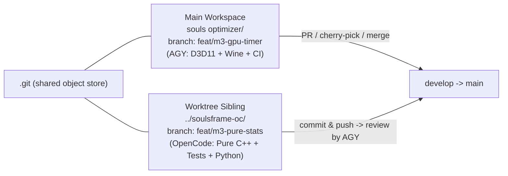
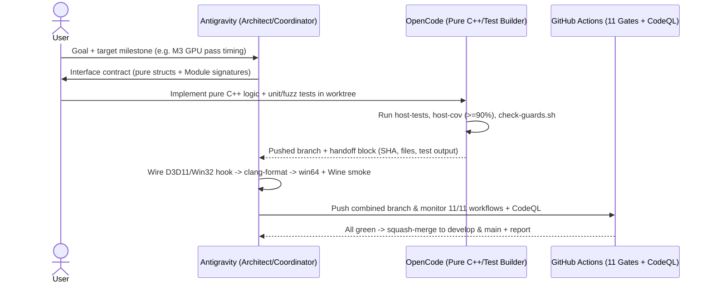

# 11. Orchestrating OpenCode + Antigravity (AGY) on SoulsFrame

This guide explains how to run **OpenCode** (fast terminal coding agent) and **Antigravity / AGY** (multi-agent coordinator with swarm, subagents, workflows, and browser/system integration) **together** on SoulsFrame without step-on-toes file conflicts, wasted tokens, or broken builds.

> Both **OpenCode** and **Antigravity (AGY)** automatically read [AGENTS.md](../AGENTS.md) at the start of every session. Treat `AGENTS.md` as the **Shared Law**, this file as the **Traffic Control & Handoff Protocol**, and [docs/12-ai-agent-playbooks-and-roles.md](12-ai-agent-playbooks-and-roles.md) as the **Role Checklists & Pitfall Manual**.

---

## 1. Division of Labor: What Each Agent Owns Best

Instead of asking both OpenCode and AGY to touch the same C++ file simultaneously, match each tool to its superpower:

| Dimension | Antigravity (AGY) — *Coordinator & Verifier* | OpenCode — *Fast Terminal Specialist* |
|---|---|---|
| **Primary Strengths** | Multi-file architecture (`/plan`), multi-agent swarms/workflows, Podman + Wine end-to-end smoke runs, GitHub Actions CI triage (`gh run view`), PR auto-merge orchestration | Rapid interactive edits in pure C++20, writing unit/fuzz tests, tight edit→compile→`ctest`→`gcovr` loops on Linux, Python analysis scripts (`tools/py/`) |
| **Best Owned Domains** | `src/gfx/d3d11/`, `src/core/dllmain.cpp`, `.github/workflows/`, `docker/`, Wine integration (`scripts/smoke-test.sh`), release & branch management | Pure modules (`src/core/`, `src/probe/trace_types.*`, `src/probe/jsonl_writer.*`, `src/timing/`, `src/tex/`, `src/hooks/sigscan.*`), `tests/unit/`, `tests/fuzz/`, `tools/py/` |
| **Container / Wine Tasks** | Owns `sf-build` & `sf-wine-test` Podman verification and `objdump -p` PE security audits | Runs fast native Linux `host-tests`, `host-asan`, `host-cov`, `check-guards.sh`, and `--self-test` loops (0.1–2s feedback) |
| **Documentation & Reports** | Final milestone synthesis (`reports/step-*.md`), updating `docs/09-codebase-reference.md` after cross-cutting merges | Updating inline `///` docstrings, TOML examples, and module-level notes as code is written |

---

## 2. Workspace Isolation with Git Worktrees (Zero File Collisions)

Running two AI tools on the **same** working directory causes silent overwrites, dirty `git status`, and corrupted `build/` CMake caches. Give **Antigravity** the primary repo directory and **OpenCode** an isolated `git worktree` on its own feature branch:



### Exact Setup Commands

Create a sibling worktree for OpenCode before starting a parallel sprint:

```bash
# From the main SoulsFrame repo root:
git worktree add ../soulsframe-oc -b feat/oc-work origin/main

# Launch OpenCode inside its dedicated worktree:
cd ../soulsframe-oc
opencode
```

When OpenCode finishes a slice and pushes its branch, inspect or merge cleanly from AGY's workspace and remove temporary worktrees later:

```bash
git worktree remove ../soulsframe-oc
```

> **Important:** Because `build/` is gitignored per worktree, OpenCode's native `build/host-cov` never collides with AGY's `build/win64-release` or `build/win64-probe`.

---

## 3. Shared Truth & Context Files (What Every Agent Reads)

Keep agent memory anchored in Git rather than stuck inside one chat window:

| File | Read by | Purpose |
|---|---|---|
| [AGENTS.md](../AGENTS.md) | AGY + OpenCode + Codex-style CLIs | Non-negotiable safety rules, layering split, exact build/guard commands, roadmap snapshot |
| [.github/copilot-instructions.md](../.github/copilot-instructions.md) | Copilot + GitHub PR reviewers | Automated review checklist matching CI gates |
| [docs/09-codebase-reference.md](09-codebase-reference.md) | All agents starting a session | Current file map, startup diagram, and live test/build counts |
| [docs/11-ai-agent-orchestration-opencode-agy.md](11-ai-agent-orchestration-opencode-agy.md) | Both tools when working in tandem | Split-of-work, worktree rules, and structured handoff contract |
| [docs/12-ai-agent-playbooks-and-roles.md](12-ai-agent-playbooks-and-roles.md) | Specialist subagents & terminal prompts | Role checklists, CI gate specs, and real bug post-mortems |
| [reports/](../reports/) | Agents resuming across sessions | Exact ledger of what landed, verified numbers, and lessons learned |

---

## 4. Standard Multi-Agent Workflow (4-Stage Pipeline)

Follow this repeatable loop for M3 (`gpu_timer` + benchmark harness), M4 (Ghidra + sigscan DB), and M5–M10 optimizations:



### Stage-by-Stage Rules

1. **Contract First (AGY):** Before splitting work, agree on pure-C++ header structs/interfaces (e.g., `src/timing/gpu_pass_stats.h` or `src/probe/trace_types.h`) with **zero** `<windows.h>`/`<d3d11.h>` types.
2. **Pure Implementation & Stress Tests (OpenCode):** OpenCode writes pure logic, unit tests (`doctest`), fuzzers (`tests/fuzz/`), and Python analyzers (`tools/py/`), verifying locally with:

   ```bash
   bash scripts/ci/check-guards.sh
   cmake --preset host-tests -DSF_WERROR=ON && cmake --build --preset host-tests && ctest --preset host-tests --output-on-failure
   SF_MIN_LINE_COVERAGE=90 bash scripts/ci/run-coverage.sh
   ```

3. **Windows Hook & Wine Smoke Integration (AGY):** AGY merges OpenCode's branch, writes/updates `src/gfx/d3d11/*.cpp` + `src/*_module.cpp`, formats inside `sf-build` (`clang-format -i`), builds `win64-release` and `win64-probe` (`-DSF_WERROR=ON`), audits `objdump -p`, and runs the headless `sf-wine-test` suite.
4. **Harsh CI & Report Gate (AGY):** Neither agent considers a milestone done until GitHub Actions passes `guards`, `gitleaks`, `docs` (`markdownlint`), `static-analysis` (`clang-format`, `clang-tidy`, `cppcheck`), 3x `host-tests` (including ASan+UBSan), `coverage`, `fuzz-smoke`, `win64`, `wine-smoke`, `docker-verify`, `security`, and `CodeQL`, with a `reports/step-*.md` written.

---

## 5. Structured Handoff Template (Copy-Paste Between OpenCode & AGY)

Whenever switching from **OpenCode -> Antigravity** (or vice versa), paste a short factual handoff note like this:

```markdown
## Agent Handoff: <branch-name> @ <commit-sha>
- **Owner completing step:** OpenCode (or AGY)
- **Files modified:** `src/...`, `tests/...`
- **Checks run & observed results:**
  - `check-guards.sh`: passed
  - `host-tests` / `run-coverage.sh`: passed (`X` cases / `Y` assertions, `Z%` lines)
  - `win64-release` & `win64-probe`: built / not run (needs AGY)
- **Next action requested for receiving agent:** Wire `ID3D11Query` timestamps in `src/gfx/d3d11/`, format in `sf-build`, run `sf-wine-test`, push & watch CI.
- **Open warnings / constraints:** Do not touch `config/soulsframe.toml.example`'s `offline_acknowledged = false`.
```

---

## 6. Copy-Paste Prompts for Users Launching Both Tools

### Prompt for OpenCode (Pure C++ + Tests + Coverage)

```text
Read AGENTS.md and docs/11-ai-agent-orchestration-opencode-agy.md first.
I am working with Antigravity (AGY) on the Windows/Wine hooks separately, so stay strictly in pure C++ (zero <windows.h>/<d3d11.h>/<dxgi.h>), tests/, config/, and tools/py/.
Implement <feature> cleanly with /// docstrings, add thorough edge-case doctest unit tests, and run `bash scripts/ci/check-guards.sh` and `SF_MIN_LINE_COVERAGE=90 bash scripts/ci/run-coverage.sh`.
Commit frequently on this worktree branch and give me the exact handoff summary for AGY when finished.
```

### Prompt for Antigravity (Windows/D3D11 + Containers + CI Orchestration)

```text
Read AGENTS.md, docs/11-ai-agent-orchestration-opencode-agy.md, and docs/12-ai-agent-playbooks-and-roles.md.
OpenCode finished the pure C++ slice on branch <branch>. Inspect it, integrate the D3D11/Win32 hook & sf::Module wiring under src/gfx/d3d11/, format via sf-build clang-format, cross-compile win64-release and win64-probe with -DSF_WERROR=ON, verify objdump -p PE mitigations + sf-wine-test, watch GitHub Actions until 100% green, write a report under reports/, and merge to develop and main.
```

---

## 7. Recommended Antigravity Slash Commands & Skills Alongside OpenCode

- Use `/plan` before splitting a new milestone (`M3`–`M8`) into OpenCode vs AGY branches.
- Use `/teamwork` when AGY needs parallel reviewers/verifiers (e.g., code reviewer + D3D11 implementer + Wine tester) cleanly inside AGY while OpenCode iterates on Python/fuzzers.
- Use `/compact` if a long debugging trace fills context before moving to the next milestone.
